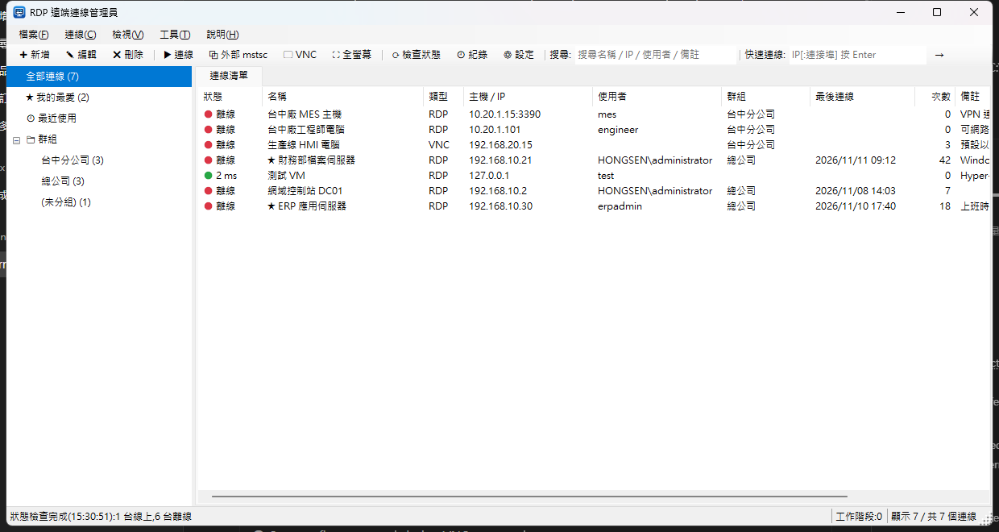
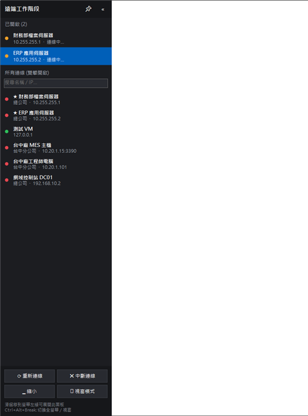

<p align="center">
  
</p>

<h1 align="center">RDP 遠端連線管理員</h1>

<p align="center">
  集中管理 Windows 遠端桌面 (RDP) 與 VNC 連線：儲存 IP 與名稱、快速搜尋、一鍵連線<br>
  <b>鴻森智能科技股份有限公司</b>
</p>

<p align="center">
  <a href="../../releases/latest">下載最新版本</a> ·
  <a href="docs/USER_MANUAL.md">使用手冊</a>
</p>

---



<p align="center"><br><sub>全螢幕模式的側邊面板</sub></p>

## 功能特色

| 類別 | 功能 |
|---|---|
| 連線管理 | 儲存名稱、IP、連接埠、帳號、網域、群組、備註、我的最愛；可新增、編輯、建立複本、刪除 |
| 密碼 | **預設不儲存**，連線前才詢問 (可臨時改用其他帳號)；勾選「記住密碼」才會加密儲存 |
| 快速尋找 | 即時搜尋 (名稱 / IP / 使用者 / 群組 / 備註，可用空白分隔多個關鍵字)；左側分類：全部、我的最愛、最近使用、群組；點欄位標題排序 |
| 兩種連線方式 | **內嵌分頁**：在程式內同時開多個遠端桌面<br>**外部 mstsc**：使用 Windows 內建遠端桌面視窗 |
| VNC 連線 | **同一個連線設定可同時設定 RDP 與 VNC**：雙擊用預設類型 (預設 RDP)，**右鍵「以 VNC 連線」或工具列「🖵 VNC」**改用 UltraVNC Viewer；RDP 與 VNC 密碼分開；支援全螢幕、自動縮放、僅檢視、MS-Logon；快速連線輸入 `vnc://IP` |
| 全螢幕工作區 | **預設全螢幕連線**；滑鼠停在左側小把手上即展開**側邊面板**，可切換電腦、開啟其他連線、縮小或回到視窗模式；面板可收合或固定，左側小把手可上下拖曳移動；縮小後點工作列即回到全螢幕；支援 Ctrl+Alt+Break 與多螢幕 |
| 內嵌工作階段 | 視窗縮放時自動調整遠端解析度、中斷時顯示原因並可一鍵重新連線 |
| 快速連線 | 在工具列直接輸入 IP 即可連線，之後可另存為連線 |
| 主機狀態 | 測試 RDP 連接埠，顯示線上 / 離線與延遲時間；可在啟動時或定時自動檢查 |
| 網路喚醒 | Wake-on-LAN 遠端開機 |
| 群組 | 拖曳連線到群組；可新增、重新命名、刪除群組；可一次連線整個群組 |
| 匯入匯出 | JSON、CSV (Excel)、.rdp 檔；把檔案拖曳到清單即可匯入 |
| 備份 | 每日自動備份 (保留 30 份)、手動備份、從備份還原 |
| 連線紀錄 | 記錄連線、登入、中斷、失敗 |
| 其他 | 系統匣常駐 (我的最愛、最近連線)、單一執行個體、命令列直接連線、可攜模式 (exe 旁建立 `data` 資料夾)、完整快捷鍵 |

## 下載與安裝

1. 從 [Releases](../../releases/latest) 下載 `RDPManager-v1.4.2-win-x64.zip`。
2. 解壓縮後執行 `RDPManager.exe`。不需要安裝 .NET。

系統需求：Windows 10 / 11 (64 位元)。VNC 連線需另外安裝 [UltraVNC](https://uvnc.com) Viewer。

詳細操作請參考 **[使用手冊](docs/USER_MANUAL.md)** (Release 也有 PDF 版)。

## 安全性

- **預設不儲存密碼**：只有勾選「記住密碼」的連線才會儲存 (可在「設定」修改預設值)。
- 已儲存的密碼使用 **Windows DPAPI** 以目前的 Windows 帳戶加密，只有同一台電腦上的同一個帳戶能解密。
- 匯出檔 (JSON / CSV / .rdp) **不包含密碼**。
- 外部 mstsc 自動登入時，帳密會暫存在 Windows 認證管理員。密碼未儲存時，mstsc 讀取後就會刪除；已儲存的則保留到登出 Windows。
- VNC：一般 VNC 連線**沒有加密**，請只在內網或 VPN 中使用；密碼會以命令列參數傳給 UltraVNC Viewer。

資料位置：`%AppData%\RDPManager\` (或 exe 旁的 `data` 資料夾)

## 從原始碼建置

需要 [.NET 9 SDK](https://dotnet.microsoft.com/download)。

```bash
dotnet build -c Release
```

```bash
dotnet run
```

發行 (單一執行檔、內含 .NET 執行環境)：

```bash
dotnet publish -c Release -r win-x64 --self-contained true -p:PublishSingleFile=true -p:IncludeNativeLibrariesForSelfExtract=true -o dist/RDPManager
```

重新產生程式圖示：

```bash
pwsh tools/make-icon.ps1
```

### 專案結構

```
Program.cs                    進入點 (單一執行個體、命令列參數)
Models/                       RdpConnection、AppSettings、HistoryEntry
Services/
  DataStore.cs                JSON 儲存、備份
  PasswordProtector.cs        DPAPI 密碼加密
  CredentialManager.cs        Windows 認證管理員 (外部 mstsc 自動登入)
  ExternalLauncher.cs         產生 .rdp 並啟動 mstsc
  VncLauncher.cs              以 UltraVNC Viewer 開啟 VNC 連線
  ImportExport.cs             JSON / CSV / .rdp 匯入匯出
  NetworkTools.cs             連接埠狀態檢查、Wake-on-LAN
  AddressParser.cs            解析 host:port / IPv6
  AppIcon.cs                  程式圖示與狀態燈號
Controls/
  RdpClientControl.cs         Windows 遠端桌面 ActiveX (mstscax) 包裝
  RdpSessionPage.cs           內嵌工作階段分頁
Forms/                        主視窗、連線編輯、設定、連線紀錄
Resources/app.ico             程式圖示
tools/make-icon.ps1           圖示產生腳本
docs/                         使用手冊與截圖
```

## 著作權

Copyright © 2026 鴻森智能科技股份有限公司. All rights reserved.

本軟體之著作權屬鴻森智能科技股份有限公司所有，詳見 [LICENSE](LICENSE)。
