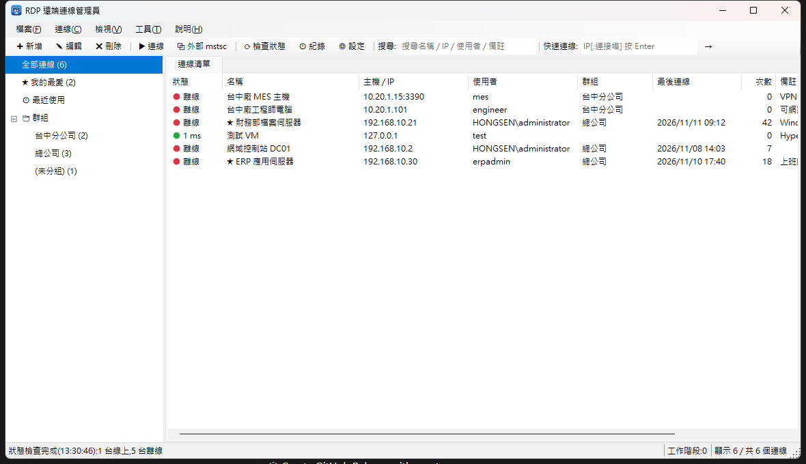
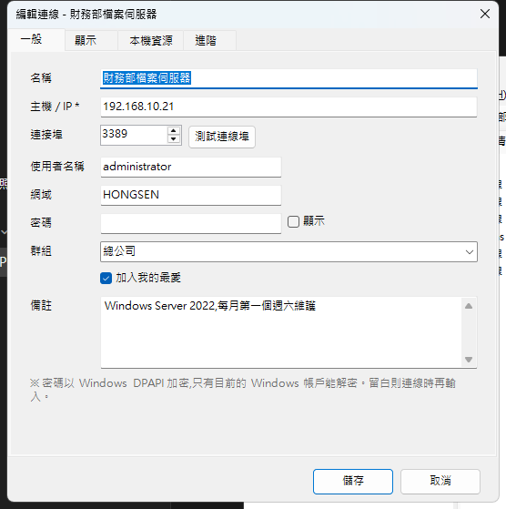
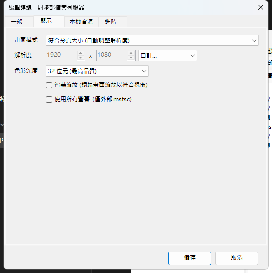
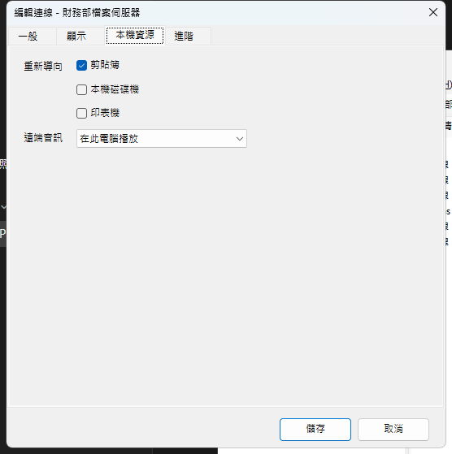
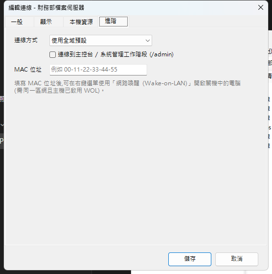
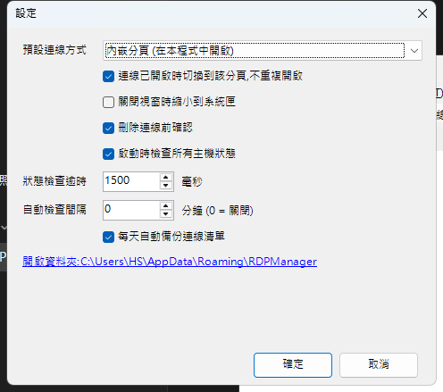

# RDP 遠端連線管理員 使用手冊

版本 1.0.0　|　鴻森智能科技股份有限公司

---

## 目錄

1. [簡介](#1-簡介)
2. [系統需求](#2-系統需求)
3. [安裝與啟動](#3-安裝與啟動)
4. [主畫面介紹](#4-主畫面介紹)
5. [新增與管理連線](#5-新增與管理連線)
6. [連線到遠端電腦](#6-連線到遠端電腦)
7. [搜尋、群組與我的最愛](#7-搜尋群組與我的最愛)
8. [主機狀態檢查](#8-主機狀態檢查)
9. [網路喚醒 (Wake-on-LAN)](#9-網路喚醒-wake-on-lan)
10. [匯入、匯出與備份](#10-匯入匯出與備份)
11. [連線紀錄](#11-連線紀錄)
12. [設定](#12-設定)
13. [快捷鍵](#13-快捷鍵)
14. [資料儲存與安全性](#14-資料儲存與安全性)
15. [常見問題](#15-常見問題)

---

## 1. 簡介

「RDP 遠端連線管理員」用來集中管理 Windows 遠端桌面 (RDP) 連線。您可以把常用主機的名稱、IP、帳號密碼存起來，之後用搜尋或群組快速找到並一鍵連線。程式支援兩種連線方式：在程式裡用分頁同時開多個遠端桌面，或用 Windows 內建的遠端桌面連線視窗開啟。

主要功能：

- 儲存連線的名稱、IP、連接埠、帳號、網域、密碼、群組與備註
- 即時搜尋，並可依群組、我的最愛、最近使用分類
- 內嵌分頁連線 (可同時開多個)，或使用外部 mstsc 視窗
- 主機線上 / 離線狀態與延遲時間檢查
- 網路喚醒 (Wake-on-LAN)
- 匯入 / 匯出 JSON、CSV、.rdp 檔
- 每日自動備份、還原
- 連線紀錄
- 系統匣常駐

## 2. 系統需求

| 項目 | 需求 |
|---|---|
| 作業系統 | Windows 10 / Windows 11 (64 位元) |
| 執行環境 | 發行版本已包含 .NET 執行環境，不需要另外安裝 |
| 遠端電腦 | 需要啟用「遠端桌面」，防火牆要允許 RDP 連接埠 (預設 3389) |
| 網路 | 本機要能連到遠端電腦的 RDP 連接埠 (若需要 VPN，請先連上 VPN) |

## 3. 安裝與啟動

1. 從 GitHub Release 頁面下載 `RDPManager-v1.0.0-win-x64.zip`。
2. 解壓縮到任意資料夾，例如 `C:\Tools\RDPManager`。
3. 執行 `RDPManager.exe`。

> **注意：** 第一次執行時，Windows SmartScreen 可能會顯示「Windows 已保護您的電腦」。請按「其他資訊」→「仍要執行」。

- 本程式同一時間只能開啟一個。重複開啟時會顯示「已在執行中」。
- 建議在 `RDPManager.exe` 上按右鍵 →「釘選到開始畫面」或「建立捷徑」。

### 命令列參數 (直接連線)

```
RDPManager.exe <已儲存的連線名稱 或 IP[:連接埠]>
```

範例：`RDPManager.exe "ERP 應用伺服器"`，或 `RDPManager.exe 192.168.10.30`。

您可以把這個指令放進桌面捷徑的「目標」欄位，按兩下捷徑就會直接連到該主機。

## 4. 主畫面介紹



| 區域 | 說明 |
|---|---|
| 選單列 | 檔案、連線、檢視、工具、說明 |
| 工具列 | 新增、編輯、刪除、連線、外部 mstsc、檢查狀態、紀錄、設定、**搜尋框**、**快速連線框** |
| 左側分類 | 全部連線、★ 我的最愛、最近使用、各群組、(未分組)，括號內是連線數量 |
| 連線清單 | 狀態燈號與延遲、名稱、IP、使用者、群組、最後連線時間、連線次數、備註。點欄位標題可排序 |
| 分頁 | 第一個分頁是「連線清單」，每個內嵌遠端桌面會各自開一個分頁 |
| 狀態列 | 目前訊息、開啟中的工作階段數、清單筆數 |

狀態燈號：🟢 線上 (顯示延遲毫秒)、🔴 離線、🟠 檢查中、⚪ 尚未檢查。

## 5. 新增與管理連線

### 新增連線

按工具列「➕ 新增」或 `Ctrl+N` 開啟編輯視窗。編輯視窗有四個分頁：

#### 一般



| 欄位 | 說明 |
|---|---|
| 名稱 | 顯示用名稱。留白時會使用主機 IP |
| 主機 / IP | **必填**。可以直接輸入 `server01:3390`，程式會自動拆出連接埠 |
| 連接埠 | 預設 3389。按「測試連線埠」可以馬上確認主機能不能連 |
| 使用者名稱 / 網域 | 例如網域 `HONGSEN`、使用者 `administrator` |
| 密碼 | 會加密保存。留白時，連線時再輸入 |
| 群組 | 可以選擇現有群組，或直接輸入新群組名稱 |
| 加入我的最愛 | 會出現在「★ 我的最愛」和系統匣選單 |
| 備註 | 任意說明，也可以被搜尋到 |

#### 顯示



- **畫面模式**
  - 符合分頁大小：遠端解析度跟著分頁大小走，調整視窗大小時會自動更新 (遠端需要 Windows 8.1 / Server 2012 R2 以上)
  - 全螢幕：連線後直接全螢幕
  - 自訂解析度：可以從常用解析度清單選擇
- **色彩深度**：預設 32 位元。網路較慢時可以改成 16 位元
- **智慧縮放**：遠端畫面比視窗大時，等比例縮小顯示
- **使用所有螢幕**：只在外部 mstsc 模式有效

#### 本機資源



可以設定是否把剪貼簿、本機磁碟機、印表機帶到遠端，以及遠端聲音要在哪裡播放。

#### 進階



- **連線方式**：使用全域預設 / 內嵌分頁 / 外部 mstsc 視窗
- **系統管理工作階段 (/admin)**：連到伺服器的主控台工作階段
- **MAC 位址**：用於網路喚醒

### 編輯、複製、刪除

先在清單中選取連線，然後：

- **編輯**：`Ctrl+E`、`F2`，或按右鍵 →「編輯」
- **建立複本**：`Ctrl+D`。適合建立設定相似的連線
- **刪除**：`Del`。可以一次選取多筆刪除
- **複製 IP 位址**：按右鍵 →「複製 IP 位址」
- **匯出為 .rdp 檔**：按右鍵 →「匯出為 .rdp 檔」。檔案可以直接用 Windows 遠端桌面開啟 (不含密碼)

## 6. 連線到遠端電腦

### 開始連線

- 在清單中**按兩下**連線，或選取後按 `Enter`
- 選取多筆後按 `Enter`，會同時開啟多個連線
- 指定連線方式：按右鍵 →「在內嵌分頁連線」/「以外部 mstsc 連線」(`Ctrl+Shift+Enter`)

### 兩種連線方式

| | 內嵌分頁 | 外部 mstsc |
|---|---|---|
| 顯示位置 | 本程式的分頁中 | Windows「遠端桌面連線」視窗 |
| 同時多台 | 用分頁切換 | 多個獨立視窗 |
| 自動調整解析度 | ✔ | ✔ |
| 多螢幕 | ✘ | ✔ |
| 自動登入 | ✔ | ✔ (透過 Windows 認證管理員) |

預設方式可以在「設定」中變更，每個連線也可以在「進階」頁個別指定。

### 快速連線

在工具列「快速連線」框輸入 IP (例如 `192.168.1.50` 或 `192.168.1.50:3390`)，再按 `Enter`。快速連線不會自動儲存。如果要保存，請在該分頁標籤上按右鍵 →「儲存為連線」。

### 工作階段分頁操作

在分頁標籤上**按右鍵**可以：

- 重新連線
- 全螢幕 (或按 `F11`。離開全螢幕請使用畫面上方的連線列)
- 改用外部 mstsc 開啟
- 中斷並關閉分頁 (也可以用**滑鼠中鍵**點分頁，或按 `Ctrl+W`)
- 關閉其他分頁

### 中斷連線

連線中斷後，分頁會顯示中斷原因，並提供「重新連線」和「關閉分頁」按鈕。常見原因請參考[常見問題](#15-常見問題)。

## 7. 搜尋、群組與我的最愛

### 搜尋

- 在工具列搜尋框輸入文字 (`Ctrl+F`)，清單會即時篩選
- 搜尋範圍包括名稱、IP、使用者、群組、備註
- 用**空白**分隔多個關鍵字時，只會列出全部符合的連線，例如 `台中 mes`
- 按 `Esc` 清除搜尋。按 `Enter` 或 `↓` 會移到清單；只有一筆結果時按 `Enter` 會直接連線

### 群組

- 群組是連線的「群組」欄位，在左側「📁 群組」下顯示
- **移動到群組**：
  - 把清單中的連線**拖曳**到左側群組
  - 或按右鍵 →「移動到群組…」
- 在左側群組上按右鍵可以：新增群組、重新命名、刪除群組 (刪除時連線會移到「未分組」，不會被刪掉)、檢查此群組狀態、連線此群組全部主機

### 我的最愛

- 按 `Ctrl+B`，或按右鍵 →「加入 / 移除我的最愛」
- 也可以把連線拖曳到左側「★ 我的最愛」

### 最近使用

列出最近連線過的 20 筆，依時間排序。

## 8. 主機狀態檢查

程式會測試每台主機的 RDP 連接埠，判斷主機是否在線上：

- 啟動時自動檢查 (可以在設定關閉)
- 按 `F5` 或工具列「⟳ 檢查狀態」檢查全部主機
- 按右鍵 →「檢查選取主機狀態」只檢查選取的主機
- 在設定中指定「自動檢查間隔 (分鐘)」，可以定時自動檢查

## 9. 網路喚醒 (Wake-on-LAN)

1. 在連線的「進階」頁填寫 MAC 位址 (例如 `00-1A-2B-3C-4D-5E`)。
2. 在清單中按右鍵 →「網路喚醒 (Wake-on-LAN)」。

> 遠端電腦的 BIOS 和網路卡要先啟用 WOL，而且通常要在同一個區域網路內才有效。

## 10. 匯入、匯出與備份

### 匯入 (`Ctrl+I`)

- 支援 **JSON**、**CSV**、**.rdp** 三種格式，可以一次選多個檔案
- 也可以直接把檔案**拖曳**到連線清單
- 主機、連接埠、使用者都相同的連線會被視為重複並略過

CSV 格式範例 (第一列是標題，可以用 Excel 編輯)：

```
Name,Host,Port,Username,Domain,Group,Notes,MacAddress,Favorite
ERP 應用伺服器,192.168.10.30,3389,erpadmin,,總公司,,,1
```

標題也可以使用中文：名稱、主機 (或 IP)、連接埠、使用者、網域、群組、備註。

### 匯出

- 「檔案 → 匯出為 JSON / 匯出為 CSV」
- 若選取了多筆連線，程式會詢問要只匯出選取的連線，還是全部匯出
- **基於安全性，匯出檔不包含密碼**

### 備份與還原

- 程式每天第一次啟動時會自動備份，最多保留 30 份
- 「檔案 → 立即備份」可以手動備份
- 「檔案 → 從備份還原」可以選擇備份檔還原。還原前，程式會先自動備份目前的資料

## 11. 連線紀錄

按 `Ctrl+H` 或工具列「🕘 紀錄」開啟。這裡會記錄每次連線的時間、主機、連線方式、結果 (開始連線、登入完成、中斷、失敗)。可以篩選或清除紀錄，最多保留 1000 筆。

## 12. 設定



| 設定 | 說明 |
|---|---|
| 預設連線方式 | 內嵌分頁或外部 mstsc |
| 連線已開啟時切換到該分頁 | 避免同一台主機重複開啟 |
| 關閉視窗時縮小到系統匣 | 開啟後按 ✕ 不會結束程式，請從系統匣圖示按右鍵 →「結束」 |
| 刪除連線前確認 | |
| 啟動時檢查所有主機狀態 | |
| 狀態檢查逾時 | 單位是毫秒，網路較慢時可以調高 |
| 自動檢查間隔 | 單位是分鐘，0 代表關閉 |
| 每天自動備份連線清單 | |

### 系統匣

在系統匣圖示上按右鍵，可以從「★ 我的最愛」或「🕘 最近連線」直接連線。

## 13. 快捷鍵

| 按鍵 | 功能 |
|---|---|
| `Ctrl+N` | 新增連線 |
| `Enter` / 按兩下 | 連線 |
| `Ctrl+Shift+Enter` | 以外部 mstsc 連線 |
| `Ctrl+E` / `F2` | 編輯 |
| `Ctrl+D` | 建立複本 |
| `Del` | 刪除 |
| `Ctrl+B` | 加入 / 移除我的最愛 |
| `Ctrl+F` | 搜尋 |
| `Ctrl+Q` | 快速連線 |
| `F5` | 重新檢查狀態 |
| `Ctrl+H` | 連線紀錄 |
| `Ctrl+I` | 匯入 |
| `Ctrl+L` | 回到連線清單 |
| `F11` | 工作階段全螢幕 |
| `Ctrl+W` / 滑鼠中鍵 | 關閉工作階段分頁 |
| `F1` | 快捷鍵一覽 |

## 14. 資料儲存與安全性

所有資料都存在 `%AppData%\RDPManager\`：

| 檔案 | 內容 |
|---|---|
| `connections.json` | 連線清單 |
| `settings.json` | 設定 |
| `history.json` | 連線紀錄 |
| `backups\` | 自動 / 手動備份 |

安全性說明：

- **密碼加密**：使用 Windows DPAPI 以目前的 Windows 帳戶加密，只有同一台電腦上的同一個帳戶能解密。把資料檔複製到其他電腦後，密碼會失效，需要重新輸入。
- **匯出不含密碼**：JSON、CSV、.rdp 匯出檔都不包含密碼。
- **外部 mstsc 自動登入**：程式會把帳密暫存在 Windows 認證管理員 (`TERMSRV/主機`)，登出 Windows 後就會自動清除。

## 15. 常見問題

**Q：連線時出現「憑證無法驗證」的警告？**
A：遠端電腦使用的是自我簽署憑證，這在內部網路很常見。確認是正確的主機後，按「是」繼續連線即可。

**Q：出現代碼 1800「您已經有一個主控台工作階段進行中」？**
A：您連到的是本機自己 (例如 127.0.0.1)，或遠端只允許一個主控台工作階段。請確認 IP 是否正確。

**Q：一直連不上，狀態顯示離線？**
A：請依序檢查：
1. 遠端電腦是否開機
2. 遠端是否啟用「遠端桌面」
3. 防火牆是否允許 3389
4. 是否需要先連 VPN
5. 連接埠是否不是預設的 3389

**Q：密碼明明有存，卻還是要求輸入？**
A：可能是在其他電腦或其他 Windows 帳戶匯入了資料，密碼無法解密。請重新編輯連線並輸入密碼。也可能是密碼已在遠端被變更。

**Q：內嵌分頁無法使用？**
A：程式會詢問是否改用外部 mstsc 連線。您也可以在「設定」把預設連線方式改成「外部 mstsc 視窗」。

**Q：如何把連線清單搬到新電腦？**
A：用「檔案 → 匯出為 JSON」，再到新電腦「匯入」。匯入後需要重新輸入密碼。

---

Copyright © 2026 鴻森智能科技股份有限公司. All rights reserved.
